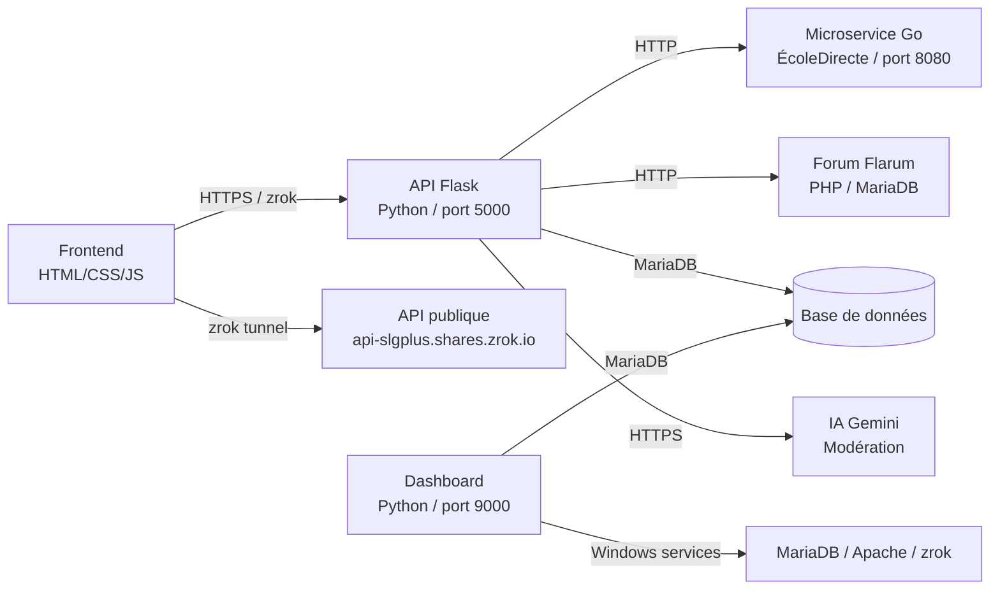

SLGPlus est structuré en 5 dépôts indépendants qui communiquent via HTTP. Chaque dépôt a un rôle précis : le frontend affiche les pages, l'API Python orchestre les données, le microservice Go gère la connexion à ÉcoleDirecte, le forum Flarum héberge les discussions et le dashboard surveille l'infrastructure.

## Schéma d'architecture



## Les 5 dépôts

| Dépôt | Technologie | Rôle | Port |
| --- | --- | --- | --- |
| [slgplus-frontend](https://github.com/SLGPlus/SLGPlus-Frontend) | HTML, CSS, JS vanilla | Pages du portail : actualités, cantine, CDI, objets perdus | 8000 (PHP intégré) |
| [slgplus-backend](https://github.com/SLGPlus/SLGPlus-Backend) | Python 3.10, Flask, Waitress | API REST, sessions, modération, passerelle forum | 5000 |
| slgplus-backend (edlogin.go) | Go 1.22 | Connexion à l'API ÉcoleDirecte avec double authentification | 8080 |
| [slgplus-backend](https://github.com/SLGPlus/SLGPlus-Backend) (flarum/) | PHP, Flarum 1.8 | Forum des élèves avec modération IA | 80 (Apache) |
| [slgplus-serverdashboard](https://github.com/SLGPlus/SLGPlus-ServerDashboard) | Python, Flask | Supervision des services Windows et de la base de données | 9000 |

## Flux de données

<AccordionGroup>
  <Accordion title="Connexion d'un élève">
    1. L'élève saisit son PIN sur `index.html`
    2. Le frontend appelle `POST /checkeleves` via le tunnel zrok
    3. L'API vérifie le hash du PIN dans `users_accounts`
    4. Une session est créée dans `sessions` et `connected_users`
    5. Le token UUID est renvoyé au frontend et stocké dans `localStorage`
  </Accordion>

  <Accordion title="Publication d'une actualité">
    1. Un utilisateur authentifié appelle `POST /news` avec un token valide
    2. L'API vérifie le rôle : `admin` publie directement, les autres passent en attente
    3. L'article est inséré dans `news_articles` avec `approved = 0` ou `1`
    4. Les articles approuvés sont listés par `GET /news`
  </Accordion>

  <Accordion title="Publication sur le forum">
    1. L'élève appelle `POST /forum/login/flarum` avec ses informations
    2. L'API crée automatiquement le compte Flarum `Prénom_Nom` s'il est nouveau
    3. L'utilisateur est ajouté au groupe de sa classe (6e: 5, 5e: 6, 4e: 7, 3e: 8)
    4. `POST /forum/post` envoie le contenu à l'API Gemini pour modération
    5. Si le contenu est accepté, il est publié via l'API REST de Flarum
  </Accordion>

  <Accordion title="Synchronisation ÉcoleDirecte">
    1. L'API Flask reçoit une requête de connexion ÉcoleDirecte
    2. Elle la transmet au microservice Go sur `localhost:8080`
    3. Le service Go gère le challenge de double authentification (code 250)
    4. Il renvoie les tokens et les données du compte à l'API Flask
  </Accordion>
</AccordionGroup>

## Choix techniques

<AccordionGroup>
  <Accordion title="Pourquoi zrok pour l'accès public ?">
    L'API utilise un tunnel zrok (`api-slgplus.shares.zrok.io`) pour être accessible depuis l'extérieur sans configuration de pare-feu. Le frontend ajoute automatiquement l'en-tête `skip_zrok_interstitial` pour contourner la page intermédiaire.
  </Accordion>

  <Accordion title="Pourquoi un microservice séparé en Go ?">
    La connexion à ÉcoleDirecte nécessite une gestion fine des cookies, des tokens et du challenge 2FA. Le microservice Go isole cette logique complexe du code Python et évite le blocage de l'API principale en cas de latence du service externe.
  </Accordion>

  <Accordion title="Pourquoi MariaDB et pas SQLite ?">
    MariaDB gère le pool de connexions (64 connexions configurées, soit environ 400 requêtes simultanées) et permet à plusieurs composants (API, dashboard, Flarum) d'accéder aux données en parallèle.
  </Accordion>

  <Accordion title="Modération par IA Gemini">
    Chaque message et titre de discussion passe par un modèle Gemini 3.1 Flash Lite. Plusieurs clés API sont utilisées en rotation pour répartir la charge. L'IA bloque les contenus inappropriés (insultes, harcèlement, informations personnelles) et corrige l'orthographe tout en conservant le ton naturel.
  </Accordion>
</AccordionGroup>

## Versions

Le backend expose sa version via `GET /` :

```json
{
  "version": "v2.0.2-SQL"
}
```

Cette version indique la branche SQL de l'API, qui repose sur MariaDB avec un pool de connexions géré par le driver Python `mariadb`.

<Tip>
  Le frontend et le backend évoluent indépendamment. Le workflow GitHub Actions du frontend déploie automatiquement sur l'hébergeur FTP à chaque merge de la branche `Dev` vers `main`.
</Tip>
