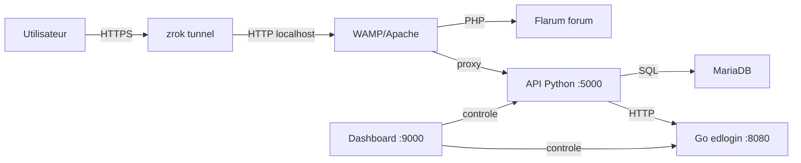

Mettre SLGPlus en production suppose de coordonner quatre éléments : le tunnel réseau (zrok) pour rendre l'API accessible depuis Internet, le serveur web qui héberge le frontend, les services Windows en arrière-plan et la possibilité d'activer un mode maintenance en cas d'intervention.

## Vue d'ensemble de l'architecture de production



Ce schéma montre le chemin d'une requête utilisateur jusqu'aux différents composants. zrok publie l'application sur une URL publique (`api-slgplus.shares.zrok.io`) tout en la laissant tourner sur la machine locale.

## Tunnel zrok

Le projet utilise [zrok](https://zrok.io/) pour exposer l'application sans configuration avancée de pare-feu. L'URL publique utilisée par le frontend est :

```text
https://api-slgplus.shares.zrok.io
```

Lors des requêtes API, le frontend ajoute l'en-tête `skip_zrok_interstitial: 1` pour éviter la page intermédiaire de confirmation de zrok. L'API CORS est configurée pour autoriser les origines du tunnel.

Sur le serveur Windows de production, zrok est installé comme service Windows via NSSM (Non-Sucking Service Manager) sous le nom `ZrokAgent`. Le dashboard de supervision peut démarrer ou arrêter ce service à la demande.

## Déploiement du frontend par FTP

Le dépôt `slgplus-frontend` contient un workflow GitHub Actions défini dans `.github/workflows/main.yml` :

- Il se déclenche automatiquement à 1h UTC (3h heure d'été française) ou manuellement via `workflow_dispatch`.
- Il fusionne la branche `Dev` dans `main` avec `theirs` (les nouveautés de `Dev` écrasent celles de `main`, sauf le fichier du workflow lui-même).
- Il synchronise le contenu par FTP vers le dossier `/htdocs/` de l'hébergeur.

Les fichiers exclus de la synchronisation sont : `README.md`, `backupof_the_site/**` et `.github/**`.

<Info>
  Le secret du serveur FTP est stocké dans les secrets GitHub (`FTP_SERVER`, `FTP_USERNAME`, `FTP_PASSWORD`). Le token de déploiement n'est jamais visible dans le code.
</Info>

## Configuration Windows et services

La production repose sur une pile Windows classique :

| Service | Nom dans Windows | Rôle |
| --- | --- | --- |
| Apache (WAMP) | `wampapache64` | Sert le frontend et le forum Flarum. |
| MariaDB | `wampmariadb64` | Base de données relationnelle. |
| zrok | `ZrokAgent` (NSSM) | Tunnel vers Internet. |

Ces trois services sont surveillés par le dashboard (`dashboard.py`). Il peut les démarrer, les arrêter ou les redémarrer via la commande Windows `sc query` et `net start/stop`.

Les processus supplémentaires suivis sont :

- `API SLGPlus Main` (mot-clé `SLGPLUS API - python app.py`)
- `Service Login Ecoledirecte` (mot-clé `edlogin.exe`)

## Mode maintenance

L'API lit un bloc `server.maintenance` dans `config.yml` :

```yaml
server:
  maintenance:
    maintenance_mode: false
    reason: ""
```

Quand `maintenance_mode` passe à `true`, l'endpoint `GET /` renvoie :

```json
{
  "message": "pong",
  "version": "v2.0.2-SQL",
  "status": {
    "maintenance": true,
    "reason": "Mise à jour en cours"
  }
}
```

Le frontend interprète ce bloc et affiche un écran de maintenance à la place de la page d'accueil.

Le dashboard permet de basculer ce flag à chaud mais avec une précision importante dans son message de confirmation :

> config.yml n'est lu qu'au démarrage de l'API. Redémarre le process API SLGPlus Main après un changement pour qu'il soit pris en compte.

<Steps>
  <Step title="Activer la maintenance depuis le dashboard">
    Accédez à l'onglet Maintenance du dashboard et cliquez sur le bouton d'activation. Renseignez un court message pour les utilisateurs.
  </Step>
  <Step title="Redémarrer l'API Python">
    Toujours dans le dashboard, utilisez le bouton de redémarrage de "API SLGPlus Main" pour que le nouveau `config.yml` soit relu.
  </Step>
  <Step title="Vérifier le retour">
    Ouvrez `https://api-slgplus.shares.zrok.io/` dans un navigateur et vérifiez que `status.maintenance` vaut bien `true`.
  </Step>
  <Step title="Désactiver après l'intervention">
    Revenez dans le dashboard, désactivez la maintenance, puis redémarrez à nouveau l'API.
  </Step>
</Steps>

## Récapitulatif des URLs publiques

| Service | URL de production | Usage |
| --- | --- | --- |
| Frontend principal | `https://slgplus.shares.zrok.io` | Portail d'entrée et pages du site. |
| API REST | `https://api-slgplus.shares.zrok.io` | Toutes les routes backend. |
| Forum Flarum | `https://forum-slgplus.great-site.net` | Forum des élèves (accédé via l'API). |
| Dashboard serveur | `http://localhost:9000` (local) | Supervision et contrôle, non exposé publiquement. |

Le dashboard reste accessible uniquement en local sur le serveur de production (`0.0.0.0:9000`). Il ne doit pas être publié sur Internet en l'état, puisque son authentification repose sur un simple mot de passe défini dans `DASH_CONFIG['password']`.
