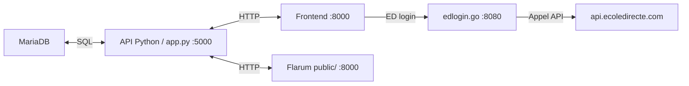

Pour contribuer à SLGPlus ou l'administrer depuis votre propre machine, vous devez faire tourner quatre briques en parallèle : l'API Python principale (Flask), MariaDB, le microservice Go (ÉcoleDirecte) et le forum Flarum (PHP). Voici la marche à suivre pour obtenir un environnement local fonctionnel sans rejoindre le codespace distant.

## Prérequis matériels

SLGPlus est pensé pour fonctionner sur un poste Windows avec WAMP, mais chaque composant peut s'installer séparément.

| Composant | Version minimale | Rôle |
| --- | --- | --- |
| Python | 3.10 ou plus | L'API principale utilise `match/case` ; ne fonctionnera pas sous 3.9. |
| MariaDB | 10.x | Stockage relationnel de toutes les données métiers. |
| Go | 1.21+ | Compilation du microservice `edlogin.go`. |
| PHP | 8.1+ | Forum Flarum, scripts côté frontend. |
| Composer | 2.x | Gestion des dépendances PHP de Flarum. |

<Note>
  Il n'existe pas encore de `requirements.txt` fourni dans le dépôt. La liste ci-dessous est déduite directement des imports réels de `app.py` et `dashboard.py`.
</Note>

## Etape 1 : installation des dépendances Python

Depuis un terminal, installez les paquets utilisés par l'API et le dashboard :

```bash pip-install
cd slgplus-backend/api_source
pip install flask flask-restful flask-cors mariadb pyyaml requests openpyxl pytz werkzeug waitress
```

Si vous comptez aussi utiliser le dashboard de supervision, ajoutez `psutil` :

```bash
pip install psutil
```

## Etape 2 : configuration de la base de données

Le projet ne fournit pas encore de script SQL de création du schéma. Vous devrez :

1. Créer une base `slgplus` dans votre serveur MariaDB local.
2. Reproduire les tables attendues par `app.py`.

Les tables utilisées sont listées ci-dessous. Leurs colonnes sont déduites des requêtes observées dans le code :

| Table | Colonnes principales | Rôle |
| --- | --- | --- |
| `users_accounts` | `id`, `username`, `role`, `pin_hash` | Comptes par rôle (élèves, bvs, admin, profs). |
| `sessions` | `token`, `user_id`, `ip_address`, `created_at`, `last_active` | Tokens de session valides. |
| `connected_users` | `session_token`, `user_id`, `ip_address`, `connected_at`, `disconnected_at` | Historique des connexions. |
| `news_articles` | `id`, `article_uid`, `author`, `title`, `content`, `image_url`, `approved`, `created_at` | Articles d'actualité. |
| `lost_and_found` | `id`, `type`, `size`, `brand`, `image`, `description`, `created_by`, `created_at` | Inventaire des objets perdus. |
| `idea` | `adresse IP`, `title`, `content`, `author` (dans cet ordre) | Boîte à idées des élèves. |
| `forum_limit_posts` | `userid` (texte), `value` (entier) | Compteur de messages forum (quotidien). |
| `forum_limit_discussions` | `userid` (texte), `value` (entier) | Compteur de discussions forum (quotidien). |

<Warning>
  Le fichier `api_config/config_template.yml` est incomplet. Notamment, il ne contient pas les clés `security.crontoken`, `forum.limits.discussions` et `forum.limits.posts`. Copiez le modèle en `config.yml` et complétez ces sections à la main.
</Warning>

## Etape 3 : copie du fichier de configuration

Depuis le dépôt backend :

```bash
# sur Windows
copy api_config\config_template.yml api_source\config.yml
# sur Linux/macOS
cp api_config/config_template.yml api_source/config.yml
```

Renseignez toutes les valeurs dans ce fichier (connexion MariaDB, clés API, PINs, etc.).

<Warning>
  Ne publiez JAMAIS ce fichier dans un dépôt Git. Il contient des secrets et des mots de passe. Pensez à le désactiver avec `git update-index --skip-worktree api_source/config.yml` ou à ajouter `config.yml` dans votre `.gitignore` local.
</Warning>

## Etape 4 : démarrer les services

Vous devez lancer quatre éléments dans l'ordre suggéré :

<Steps>
  <Step title="MariaDB">
    Vérifiez que le service est démarré. Sous Windows avec WAMP, il porte généralement le nom `wampmariadb64`.
  </Step>
  <Step title="API Python principale">
    ```bash
    cd api_source
    python app.py
    ```

    Waitress sert l'application sur `0.0.0.0:5000` avec 32 threads.
  </Step>
  <Step title="Microservice ÉcoleDirecte (Go)">
    Depuis un second terminal :

    ```bash
    cd api_source
    go run edlogin.go
    ```

    Il écoute sur `localhost:8080` et relaye les appels vers l'API ÉcoleDirecte.
  </Step>
  <Step title="Forum Flarum (PHP)">
    Depuis un troisième terminal :

    ```bash
    cd api_source/flarum
    composer install
    ```

    Servez ensuite le dossier `public/` via Apache, PHP-FPM, ou simplement :

    ```bash
    php -S localhost:8000 -t public/
    ```
  </Step>
</Steps>

## Alternative : utiliser le codespace

Si vous préférez ne rien installer, le projet prévoit un environnement GitHub Codespace sur la branche `Dev`. Dans le frontend, le README mentionne explicitement :

> Il faut utiliser le codespace.

Une fois dans le codespace, clonez le dépôt backend, complétez votre `config.yml`, puis suivez les étapes de démarrage ci-dessus.

## Tester le frontend en local

Le frontend étant du HTML/CSS/JS vanilla sans build, vous pouvez le servir localement :

```bash
cd slgplus-frontend
php -S localhost:8000
```

Ouvrez ensuite `http://localhost:8000/` dans votre navigateur. Le frontend appellera les routes de production à travers le tunnel zrok (`api-slgplus.shares.zrok.io`). Si vous souhaitez pointer vers votre API locale, modifiez les URLs dans `scripts/common/api.js`.

<Tip>
  Ajoutez un paramètre de bypass cache aux ressources statiques pour éviter que le navigateur ne garde une ancienne version du site en mémoire, notamment sous Safari. Le frontend utilise déjà `?cp=<horodatage>` dans certains de ses liens.
</Tip>

## Vue récapitulative



Ce schéma montre les flux principaux entre la base, l'API, le microservice Go et le frontend. Toutes les requêtes passent par l'API Python qui centralise l'authentification, la modération et la gestion des données.

## Ce qui manque aujourd'hui

Le dépôt est en cours de consolidation. Les points suivants n'ont pas encore été formalisés :

- Pas de `requirements.txt` officiel (listez les paquets à la main).
- Pas de script SQL de création des tables (reconstruisez les schémas depuis les requêtes du code).
- Le modèle `config_template.yml` est incomplet pour certaines clés de `security` et `forum.limits`.

N'hésitez pas à ouvrir une issue sur GitHub si vous bloquez sur l'un de ces points.
