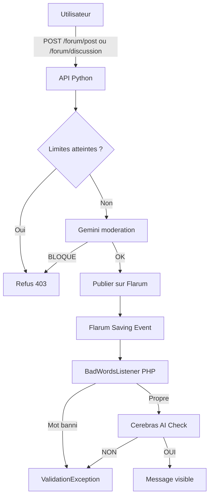

Le forum de SLGPlus est doublement protégé par l'intelligence artificielle : d'abord au niveau de l'API Python via un modèle Gemini, puis au niveau du forum Flarum lui-même via un listener PHP et un service Cerebras. Chaque message et chaque titre traversent ces couches avant d'être publiquement visibles. Cette page vous explique leur fonctionnement, le format du prompt et les limites imposées aux utilisateurs.

## Ordre des vérifications

Lorsqu'un élève publie un message ou crée une discussion, les étapes suivantes s'enchaînent :



Aucun contenu n'atteint le forum sans avoir passé ces deux portes. Si une seule échoue, la publication est bloquée.

## Couche 1 : le modérateur Gemini dans l'API Python

L'API utilise le modèle `gemini-3.1-flash-lite` avec rotation de clés définies dans `config.yml` sous `apikeys.gemini_keys`. Vous pouvez fournir plusieurs clés : l'API les fait tourner automatiquement avec `_get_next_gemini_key()`.

### Format du prompt imposé

Le prompt est trilingue et impose un format de réponse strict. Le modèle doit répondre EXACTEMENT avec ces trois lignes :

```text
STATUT: OK ou BLOQUE
RAISON: (l'avertissement direct, uniquement si BLOQUE)
MESSAGE: (le texte corrigé, uniquement si OK)
```

Le prompt détaille les motifs de refus : insultes, harcèlement, contenu choquant, spam, informations personnelles, abréviations excessives, brainrot typiquement collégien (`skibidi`, `apagnan`, etc.) et surtout les **acrostiches masqués** via les majuscules au milieu d'une phrase. Il est précisé que `ED` est un acronyme autorisé.

Si le statut est `BLOQUE`, l'API retourne immédiatement au frontend :

```json
{
  "message": "refused",
  "reason": "Ton message contient des insultes ! Des avertissements repetes entraineront des sanctions !"
}
```

Si le statut est `OK`, le champ `MESSAGE` est nettoyé (suppression des guillemets superflus) et utilisé comme contenu final envoyé à Flarum.

### Limites de fréquence

Chaque utilisateur non administrateur a droit :

- à **2 messages par jour** via `/forum/post`
- à **1 discussion par jour** via `/forum/discussion`

Ces valeurs sont configurables dans `config.yml` sous `forum.limits.posts` et `forum.limits.discussions`. L'API compte les publications dans les tables `forum_limit_posts` et `forum_limit_discussions`. Quand un utilisateur atteint la limite de messages, il est automatiquement ajouté au **groupe Flarum 9** :

```python
if row[0] == MAX_FORUM_POSTS - 1 and table == "forum_limit_posts":
    _add_flarum_groups(userid, 9)
```

Les compteurs sont remis à zéro chaque jour par le cron (`/cron/cleancounter`), qui supprime aussi le groupe 9 de tous les utilisateurs concernés.

<Warning>
  Actuellement, `config_template.yml` ne contient pas les clés `forum.limits.discussions` ni `forum.limits.posts`. Renseignez-les à la main dans votre `config.yml`, sinon l'API levera une exception `KeyError` au démarrage.
</Warning>

## Couche 2 : le listener PHP BadWordsListener dans Flarum

Le fichier `flarum/extend/BadWordsListener.php` s'accroche à l'événement `Flarum\Post\Event\Saving`. Il constitue une seconde frontière, côté serveur forum.

### Liste de mots locale

Le listener charge un fichier texte `badwords_fr.txt` placé dans le dossier `extend/`. Chaque ligne correspond à un mot interdit. Le contenu est normalisé (minuscules, suppression des espaces, remplacement de leetspeak comme `3` par `e`) avant la comparaison.

<Note>
  Le fichier `badwords_fr.txt` n'est pas présent dans le dépôt à ce jour. Créez-le manuellement dans `flarum/extend/badwords_fr.txt` si vous souhaitez activer cette vérification.
</Note>

### Vérification Cerebras

Si aucun mot local n'est détecté, le listener interroge l'API Cerebras avec le modèle `gpt-oss-120b`. Le modèle reçoit un prompt système résumant le règlement du forum (6 règles) et doit répondre par `OUI` ou `NON: raison`.

```php
$systemPrompt = "Tu es moderateur d'un forum scolaire francais...";
```

En cas de réponse commençant par `NON`, le listener lève une `ValidationException` : le message n'est pas sauvegardé et l'utilisateur voit le refus.

<Warning>
  Le secret d'API Cerebras est écrit en dur dans le fichier `BadWordsListener.php`. Pensez à le remplacer et ne publiez jamais ce fichier. Utilisez des variables d'environnement pour stocker vos clés.
</Warning>

### CORS inter-services

Le fichier `extend/CorsMiddleware.php` autorise explicitement trois origines :

- `https://forum-slgplus.great-site.net`
- `https://slgplus.shares.zrok.io`
- `https://api-slgplus.shares.zrok.io`

Il court-circuite les requêtes `OPTIONS` pour éviter que Flarum n'essaie de les router comme une route classique.

## Ce qui arrive si Gemini est indisponible

Si l'appel à Gemini échoue (timeout, quota dépassé, etc.), le bloc `except` retourne un résultat pass-through :

```python
return {"blocked": False, "reason": None, "corrected": content}
```

Le message est donc transmis tel quel à Flarum. C'est un choix de résilience, mais il suppose que le listener Cerebras de Flarum sera là pour rattraper le contenu.

## Bilan et limites

- Les deux couches n'utilisent pas le même modèle ni le même hébergeur, ce qui offre une redondance partielle en cas d'indisponibilité d'un fournisseur.
- Le groupe 9 reste un moyen simple de limiter la publication sans toucher au code du forum.
- Les clés API sont présentes en clair dans le code (Gemini via `config.yml`, Cerebras dans `BadWordsListener.php`). Pensez à les faire tourner régulièrement en cas de doute.
