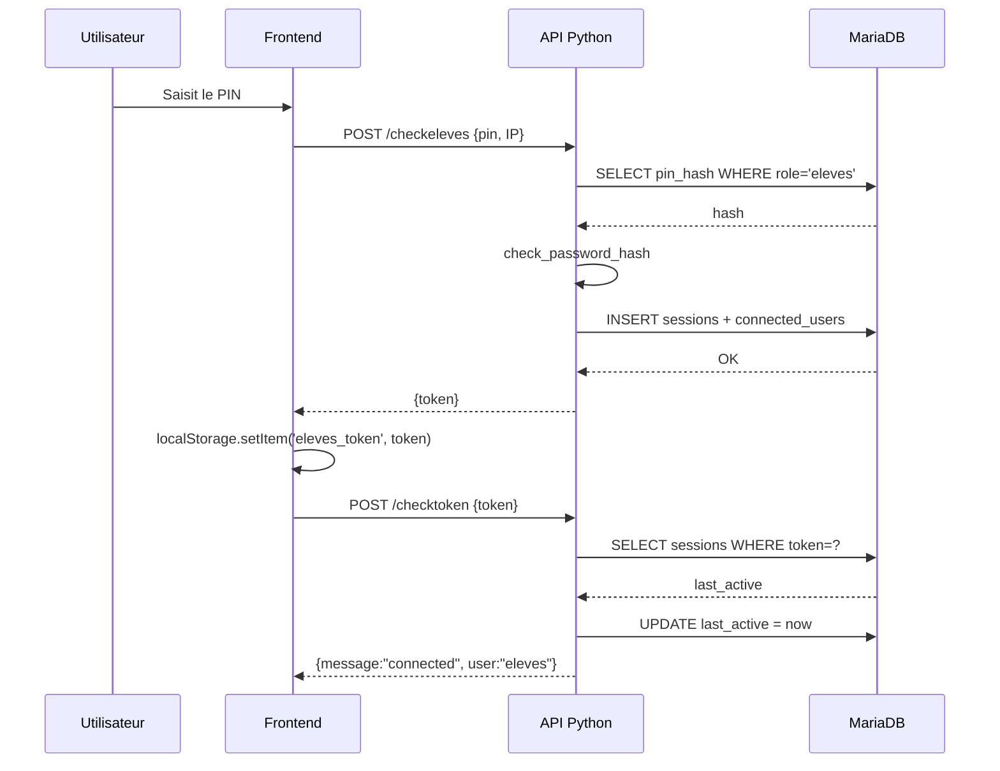

SLGPlus n'utilise pas de comptes nominatifs liés à une adresse email. L'accès est organisé autour de quatre rôles, chacun protégé par un PIN. Une session est un token éphémère qui expire automatiquement après un temps d'inactivité. Cette page vous explique comment cela fonctionne pour vous connecter, rester authentifié et comprendre les droits associés à chaque rôle.

## Les quatre rôles

| Rôle | Utilisateur cible | Droits principaux |
| --- | --- | --- |
| `eleves` | Élèves du collège | Lecture des actualités, dépôt d'idées, accès au forum. |
| `bvs` | Vie scolaire (BVS) | Gestion des objets perdus et des déclarations de perte. |
| `admin` | Administrateur | Modération des articles, modification des PINs, accès aux données non publiques. |
| `profs` | Professeurs | Rôle par défaut de l'endpoint `/login` si vous ne précisez rien. |

Les PINs ne sont pas stockés en clair. Le hash est conservé dans `users_accounts.pin_hash`, et chaque tentative de connexion est validée avec `check_password_hash` fourni par Werkzeug.

## Connexion et création de session

La création d'une session se déclenche par deux endpoints distincts :

- `/login` accepte un `user` (rôle) et un `pin`. Par défaut, si vous ne fournissez pas `user`, il tombe sur `profs`.
- `/checkeleves` est dédié aux élèves. Il vérifie un PIN spécifique et autorise l'entrée des testeurs si le PIN correspond à `TESTERSPIN`.

<Steps>
  <Step title="Saisie du PIN">
    L'utilisateur entre son code sur `index.html`. Le frontend appelle l'API avec un corps JSON contenant le PIN, et ajoute automatiquement le champ `IP`.
  </Step>
  <Step title="Vérification du hash">
    L'API relit `users_accounts.pin_hash` pour le rôle demandé et compare avec `check_password_hash`.
  </Step>
  <Step title="Émission du token">
    Si le PIN est correct, un token UUID est généré via `uuid.uuid4().hex`, puis stocké dans `sessions` et `connected_users`.
  </Step>
  <Step title="Utilisation du token">
    Le frontend conserve le token dans `localStorage` (clé `eleves_token`) et le renvoie à chaque requête protégée.
  </Step>
</Steps>

<Warning>
  Le PIN testeur est défini dans `config.yml` sous la clé `security.testers_pin`. Les élèves qui utilisent ce code ne constitueront pas une session classique : ils sont redirigés vers une page de test cachée (`trfdyhbyxwzexvbhjbvcdrswqsrttyuiohvgfder.html`).
</Warning>

## Durée de vie et invalidation des sessions

`security.session_ttl` (en secondes) définit le temps maximum d'inactivité toléré. Par défaut dans le template, la valeur semble autour de 86400 secondes (24 heures), mais relisez votre `config.yml` pour la valeur exacte sur votre instance.

A chaque appel à `_session_valid(token)`, l'API vérifie que `last_active` n'est pas trop éloigné de `time.time()`. Si le délai est dépassé :

```python
now = int(time.time())
if now - session["last_active"] > SESSION_TTL:
    cur.execute("DELETE FROM sessions WHERE token=?", (token,))
```

La ligne est supprimée. Le token devient invalide et le frontend est redirigé vers la page d'accueil.

### Déconnexion explicite

La route `/logout` détruit le token de façon immédiate :

```python
def _destroy_session(token):
    conn = db()
    cur = conn.cursor()
    now = int(time.time())
    cur.execute("UPDATE connected_users SET disconnected_at=? WHERE session_token=?", (now, token))
    cur.execute("DELETE FROM sessions WHERE token=?", (token,))
    conn.commit()
    conn.close()
```

À la fois `sessions` et `connected_users` sont mis à jour, ce qui permet de conserver un historique des connexions déjà terminées.

## Vérification du token à chaque page

Le fichier `navbar.js` est chargé sur toutes les pages du frontend. Il appelle `/checktoken` au chargement pour valider que la session est toujours active. Si le token est absent ou invalide, l'utilisateur est redirigé vers `/` (la page de connexion).

```bash POST /checktoken
# Corps JSON
{ "token": "aabbccdd..." }
```

Réponses possibles :

| Code | Corps | Signification |
| --- | --- | --- |
| 200 | `{"message":"connected","user":"eleves"}` | Session valide, rôle renvoyé. |
| 401 | `{"message":"error"}` | Token absent ou expiré. |

## Schéma simplifié du cycle de session



Ce diagramme montre la liaison complète : du PIN saisi à la vérification récurrente du token, avec mise à jour de l'horodatage d'activité.

## Bonnes pratiques

- Ne partagez jamais le PIN d'un rôle, même au sein de votre classe. Si vous soupçonnez une fuite, demandez à un administrateur de le faire changer via `/admin/setpin`.
- Le frontend conserve le token dans `localStorage`. Videz cette valeur si vous utilisez un appareil partagé.
- Les appels API depuis le frontend incluent automatiquement le champ `IP`. Ne le retirez pas, car c'est une donnée attendue par `_client_ip()`.

<Info>
  L'administrateur peut forcer la rotation d'un PIN sans couper les sessions actives, puisque la vérification se fait au moment de la connexion. Toutefois, pour bloquer immédiatement un utilisateur connecté en amont, il faut supprimer directement son token dans la table `sessions` ou attendre la fin du TTL.
</Info>
