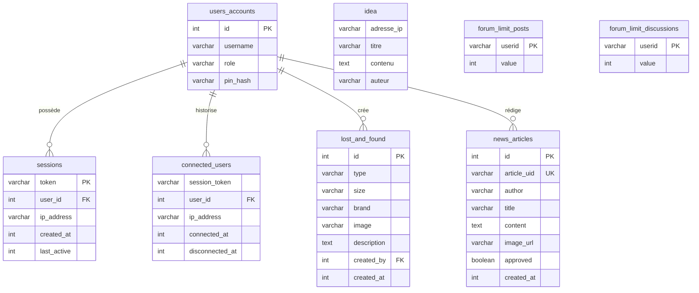

L'API SLGPlus s'appuie sur MariaDB pour stocker les sessions, les articles, les objets perdus, les idées et les limites du forum. Le dashboard lit ces mêmes tables pour ses analytics et gère ses propres données dans une SQLite embarquée.

<Warning>
  Le dépôt ne contient pas encore de script SQL de création du schéma. Les tables doivent être créées manuellement ou via un ORM.
</Warning>

---

## Tables MariaDB (API principale)

### users_accounts

Comptes de connexion par rôle (élèves, admin, BVS, profs).

| Colonne | Type | Description |
| --- | --- | --- |
| `id` | INTEGER (PK) | Identifiant interne |
| `username` | VARCHAR | Nom d'affichage |
| `role` | VARCHAR | Rôle : `eleves`, `admin`, `bvs`, `profs` |
| `pin_hash` | VARCHAR | Hash Werkzeug du PIN |

### sessions

Sessions actives avec IP et date de dernière activité.

| Colonne | Type | Description |
| --- | --- | --- |
| `token` | VARCHAR (PK) | Token UUID hexadécimal |
| `user_id` | INTEGER | Référence `users_accounts.id` |
| `ip_address` | VARCHAR | Adresse IP du client |
| `created_at` | INTEGER | Timestamp de création |
| `last_active` | INTEGER | Timestamp de dernière activité |

### connected_users

Historique des connexions et déconnexions.

| Colonne | Type | Description |
| --- | --- | --- |
| `session_token` | VARCHAR | Token de session |
| `user_id` | INTEGER | Référence `users_accounts.id` |
| `ip_address` | VARCHAR | Adresse IP |
| `connected_at` | INTEGER | Timestamp de connexion |
| `disconnected_at` | INTEGER | Timestamp de déconnexion (NULL si actif) |

### news_articles

Articles publiés ou en attente de modération.

| Colonne | Type | Description |
| --- | --- | --- |
| `id` | INTEGER (PK) | Identifiant interne auto-incrémenté |
| `article_uid` | VARCHAR (unique) | ID public généré aléatoirement (6 caractères) |
| `author` | VARCHAR | Auteur de l'article |
| `title` | VARCHAR | Titre |
| `content` | TEXT | Contenu |
| `image_url` | VARCHAR | URL de l'image |
| `approved` | BOOLEAN | `1` approuvé, `0` en attente |
| `created_at` | INTEGER | Timestamp de création |

### lost_and_found

Objets perdus saisis par la vie scolaire.

| Colonne | Type | Description |
| --- | --- | --- |
| `id` | INTEGER (PK) | Identifiant interne |
| `type` | VARCHAR | Type d'objet |
| `size` | VARCHAR | Taille |
| `brand` | VARCHAR | Marque |
| `image` | VARCHAR | URL de l'image |
| `description` | TEXT | Description |
| `created_by` | INTEGER | Référence `users_accounts.id` |
| `created_at` | INTEGER | Timestamp |

### idea

Boîte à idées des élèves (adresse IP, titre, contenu, auteur).

| Colonne | Type | Description |
| --- | --- | --- |
| `adresse_ip` | VARCHAR | IP du déposant |
| `titre` | VARCHAR | Titre de l'idée |
| `contenu` | TEXT | Description |
| `auteur` | VARCHAR | Nom de l'auteur |

### forum_limit_posts

Compteur quotidien de messages par utilisateur Flarum.

| Colonne | Type | Description |
| --- | --- | --- |
| `userid` | VARCHAR (PK) | ID utilisateur Flarum |
| `value` | INTEGER | Nombre de messages postés aujourd'hui |

### forum_limit_discussions

Compteur quotidien de discussions par utilisateur Flarum.

| Colonne | Type | Description |
| --- | --- | --- |
| `userid` | VARCHAR (PK) | ID utilisateur Flarum |
| `value` | INTEGER | Nombre de discussions créées aujourd'hui |

---

## Tables SQLite (Dashboard)

### metrics

Historique long terme des métriques système (3 jours).

| Colonne | Type | Description |
| --- | --- | --- |
| `ts` | INTEGER | Timestamp |
| `cpu` | REAL | Pourcentage CPU |
| `ram` | REAL | Pourcentage RAM |
| `disk` | REAL | Pourcentage disque principal |
| `net_sent` | REAL | Débit montant en Ko/s |
| `net_recv` | REAL | Débit descendant en Ko/s |
| `sessions` | INTEGER | Nombre de sessions actives SLGPlus |

### todos

Tâches du dashboard.

| Colonne | Type | Description |
| --- | --- | --- |
| `id` | INTEGER (PK) | Identifiant auto-incrémenté |
| `text` | TEXT | Contenu de la tâche |
| `done` | INTEGER | `0` ou `1` |
| `created_at` | INTEGER | Timestamp |

---

## Diagramme entité-relation

---

## Points de vigilance

<Accordion title="Aucun script de création du schéma">
  Le dépôt ne fournit pas de fichier `.sql` pour créer les tables. En environnement de développement, il faut soit les créer manuellement, soit utiliser un outil comme Flask-Migrate.
</Accordion>

<Accordion title="Compteurs de forum remis à zéro par cron">
  Les tables `forum_limit_posts` et `forum_limit_discussions` sont vidées quotidiennement par `/cron/cleancounter`. Le groupe de restriction `9` est également retiré des utilisateurs concernés.
</Accordion>

<Accordion title="Table idea sans clé primaire">
  La table `idea` n'a pas de colonne `id` auto-incrémentée dans le code actuel. Les insertions se font via `INSERT INTO idea VALUES (?,?,?,?)` dans l'ordre : IP, titre, contenu, auteur.
</Accordion>
